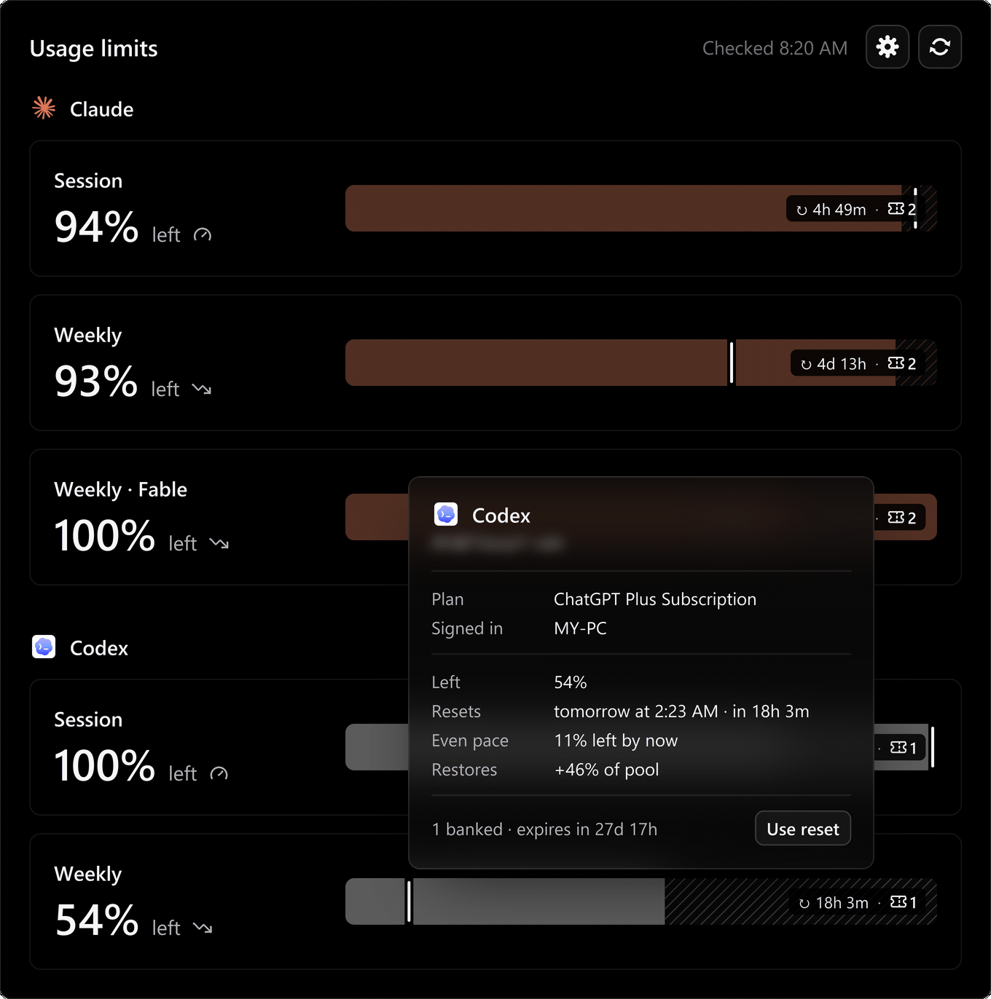
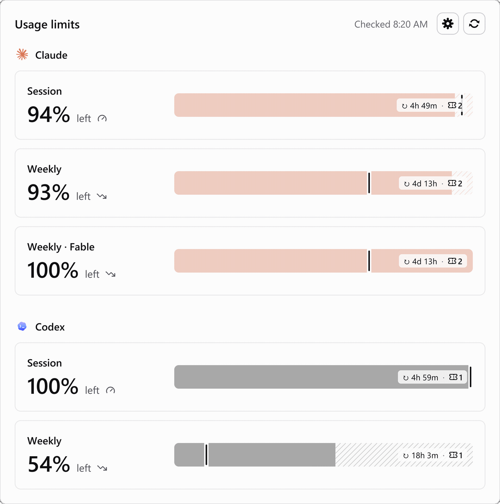
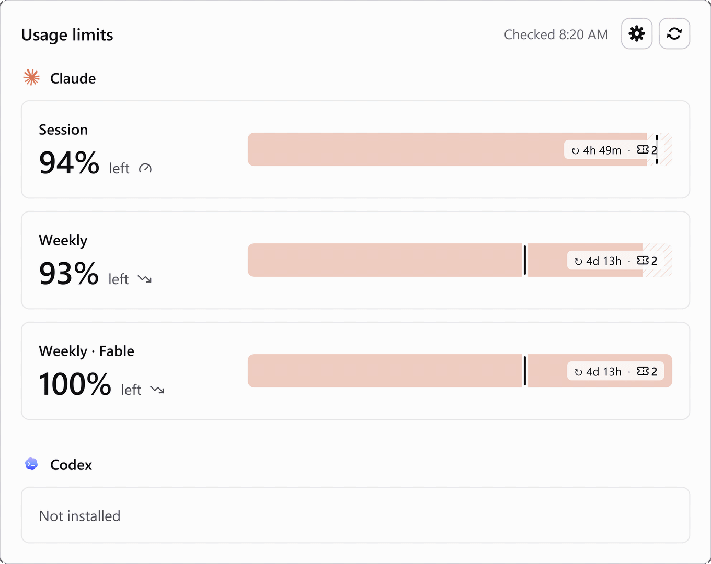

# AI Usage

A Windows tray app that shows how much of your Claude Code and Codex plan limits you have left, as two numbers next to the clock.



The window in dark mode, with the card that opens when you hover a bar.

Not made by or affiliated with Anthropic or OpenAI.
Claude and Codex logos are trademarks of Anthropic and OpenAI.
Logo images come from [Lobe Icons](https://github.com/lobehub/lobe-icons) (MIT, see `usage_tray/logos/LICENSE`).

## Install or update

Paste this into PowerShell. You don't need admin rights or Python.

```powershell
irm https://raw.githubusercontent.com/Ahmadelmacho/ai-usage/main/get.ps1 | iex
```

Run the same command to update. It downloads `AIUsage.zip` from the latest release, checks its SHA-256 against the one GitHub lists, and swaps in the new app. If the update fails, the old app comes back.

The app looks for a new release a minute after it starts and every 6 hours after that. When one is out, the tray menu and the window show **Update to vX.Y.Z**, and one click installs it. To look right away, use **Check for updates** in the tray menu or the window.

## What you need

- Windows 10 or 11.
- Claude Code, Codex or both, signed in with a subscription (Claude Pro/Max or a ChatGPT plan). An API-key login has no plan limits, so the app shows "no limits for this login".

## What it shows

- Orange number: Claude's 5-hour % left, or the weekly one if your plan has no 5-hour limit. White number: Codex's 5-hour % left, or the weekly one if your plan has no 5-hour limit. Both turn amber at 25% and red at 10%.
- If Claude Code or Codex is not installed or not signed in, it gets no number. The window shows a small "Not installed" or "Not signed in" card for it, and the number comes back by itself within 5 minutes of a sign-in (or at once on Refresh). If neither one works, the Claude number stays as "–" so you can still open the app.
- Hover a number for reset times. Click it to open the window. Right-click for Check for updates, Refresh, Open and Close.
- In the window, hover a bar for a card with your email, plan, this PC's name, what's left, when it resets and how you compare to an even pace. The email stays blurred until you click it. Settings has Dark, Light and Match Windows.
- It checks every 5 seconds. When a check fails, it keeps showing the last good numbers and tries again a little later.
- Free resets: when Claude or Codex gives you free limit resets, each bar shows how many you have, and the hover card shows each kind and when it expires. Each kind has a **Use** button (**Use reset** for Codex). It asks "Use a … reset?" first, because a used reset can't be given back.

## What it looks like


The two tray numbers: Claude in orange, Codex in white.



The window in light mode.



When Codex is not installed, it gets a small card and no tray number.

The pictures are drawn from made-up numbers with `python docs/screenshots/make.py`.

## What it reads

- For free resets only, it reads your Claude login key: the `claudeAiOauth.accessToken` value in `~/.claude/.credentials.json` (or in your `CLAUDE_CONFIG_DIR`). It reads the file only when it makes one of the two reset calls below. It sends the key only to `https://api.anthropic.com`, with Windows' certificate check on. It never saves, logs or refreshes the key, and never writes the file. If the key is missing or expired, the app shows no Claude resets.
- For `~/.codex/auth.json` it looks only at the time the file changed, to notice a new login.
- From `~/.claude.json` it reads three values: your account id, your organization id (for a Claude reset) and the usage numbers Claude saved.
- Your email and plan come from answers the two programs already give (see below). The app shows them only in the window. It never saves, logs or sends them.
- It sends no prompts, so it spends no tokens.
- It keeps the last numbers and a log in `%LOCALAPPDATA%\AIUsage`. The log can hold error text from the CLIs, so read it before you share it.

## How it works

It asks your own signed-in `claude` and `codex` programs, the same way [T3 Code](https://github.com/pingdotgg/t3code) (MIT) does:

- Claude: `claude -p --input-format stream-json`, then the control request `get_usage`. Anthropic doesn't document this request, so a Claude Code update can break it. The email and plan come from Claude's `initialize` answer.
- Codex: `codex app-server`, then the documented methods `account/rateLimits/read` and `account/read` (for the email).
- Claude free resets: `GET https://api.anthropic.com/api/oauth/usage?cedar_ember=1`, at most every 5 minutes. **Use** sends `POST /api/organizations/<your org>/reset_rate_limits`. Anthropic doesn't document these calls either.
- Codex free resets come in the `account/rateLimits/read` answer. **Use reset** sends `account/rateLimitResetCredit/consume`.

Both programs stay running between checks, with plugins and auto-updates off. The app restarts them every 30 minutes, after a failed check, and when you switch accounts. When the app quits, they quit too.

Claude Code is often rate-limited when it fetches usage, and then answers with numbers it saved earlier. When those are more than 2 minutes old, the app says "numbers from 3:00 PM" instead of "checked".

## Build from source

Needs Python 3.13.

```powershell
py -3.13 -m venv .venv
.\.venv\Scripts\pip install --require-hashes -r requirements.lock
.\build.ps1      # makes dist\AIUsage\AIUsage.exe (stops a running copy first)
.\install.ps1    # adds the shortcuts and starts it
.\.venv\Scripts\python -m pytest -q    # set $env:LIVE=1 to also test your real, signed-in CLIs
```

`requirements.lock` pins every package by hash. After you change `requirements.txt`, remake it on Windows with Python 3.13: `pip-compile --generate-hashes --allow-unsafe --strip-extras --no-emit-index-url --output-file=requirements.lock requirements.txt`.

To release, set `__version__` in `usage_tray/__init__.py`, commit, and push a tag such as `v1.0.1`. GitHub Actions tests, builds and publishes it.

## Uninstall

1. Right-click a tray number and choose Close.
2. Delete `AI Usage.lnk` from the Start menu (`shell:programs`) and from `shell:startup`.
3. Delete `%LOCALAPPDATA%\Programs\AIUsage` and `%LOCALAPPDATA%\AIUsage`.

## License

MIT. See `LICENSE`.
